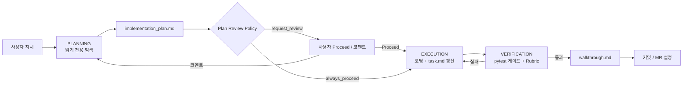
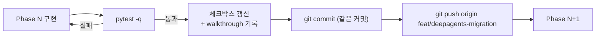

# deepagents 단일 엔진 전환 — 재시작 실행 계획 (v2, 커밋 보호형)

> **이어받는 에이전트에게**: 아래 [진행 체크리스트](#진행-체크리스트)에서 첫 번째 미완료 Phase부터 이어서 진행하세요.
> 브랜치는 `feat/deepagents-migration`. 규칙: **Phase 완료 → `pytest -q` 통과 → 체크박스 갱신 + [walkthrough](deepagents-migration-walkthrough.md)에 해당 Phase 기록 추가 → 같은 커밋 → `git push origin feat/deepagents-migration`**.
>
> 이 마이그레이션 작업 자체도 아래 [에이전트 작업 형식](#에이전트-작업-형식--antigravity-차용)을 따릅니다. 이 문서가 `implementation_plan.md`, 아래 체크리스트가 `task.md`, [`deepagents-migration-walkthrough.md`](deepagents-migration-walkthrough.md)가 `walkthrough.md` 역할입니다.

멈춘 세션(`e6298df1…`)의 계획을 **현재 저장소 상태(`main@99e9ee7`, 66 passed)** 기준으로 다시 짠 계획입니다. 이전 세션의 walkthrough 단계(자체 while 루프 Closed-Loop 재구축)는 푸시되지 않아 사라졌으므로, 그 단계를 재현하지 않고 **현재 코드에서 바로 `deepagents`로** 갑니다.

## 진행 체크리스트

- [x] Phase 0 — 계획 보관 (`docs/plans/deepagents-migration.md`)
- [x] Phase 1 — 의존성 & LangChain 모델 팩토리 (`app/core/llm/`)
- [x] Phase 2 — `GuardedWorktreeBackend` (`app/domains/execution/`)
- [x] Phase 3 — `DeepAgentRuntime` (옆에 추가)
- [ ] Phase 4 — Execution API (`POST /api/code-mode/agent`)
- [ ] Phase 5 — Build & Review (`task_service.py`)
- [ ] Phase 6 — 멀티에이전트 팀 & mock 완전 제거
- [ ] Phase 7 — 관제 UI
- [ ] Phase 8 — 아키텍처 규칙, 문서, PR

### 재개 방법

새 세션에서 다음 한 줄이면 됩니다.

> "`docs/plans/deepagents-migration.md` 보고 다음 미완료 Phase부터 이어서 해줘"

## 개발 환경

검증된 패키지 조합: `deepagents 0.7.41`, `langchain 1.5.2`, `langchain-core 1.8.4`, `langchain-openai 1.8.5`, `langchain-google-genai 4.5.2`, `langgraph 1.2.24`.

| 환경 | 셋업 | 테스트 |
|:-|:-|:-|
| **WSL2 Ubuntu (기본 작업 환경)** | 작업 사본: `/home/abyss/projects/coding_agent` (Windows에서는 `\\wsl.localhost\Ubuntu\home\abyss\projects\coding_agent`). Ubuntu 26.04에는 Python 3.14만 있고 `python3-venv`가 없어 사용자 영역 `uv`로 3.12를 씁니다: `~/.local/bin/uv venv --seed --python 3.12 .venv` → `~/.local/bin/uv pip install --python .venv/bin/python -e . "deepagents==0.7.41" "langchain-openai>=1.0"` | `.venv/bin/pytest -q` |
| Windows (PowerShell) | `py -3.12 -m venv .venv` → `.venv\Scripts\pip install -e . "deepagents==0.7.41" "langchain-openai>=1.0"` | `.venv\Scripts\pytest -q` |

- 기준선: `main@99e9ee7`에서 **66 passed** (Linux). Phase 1 이후 WSL2에서 **72 passed**를 확인했습니다. Windows 네이티브에서는 OS 차이로 12건이 실패합니다(목록은 [walkthrough Phase 0](deepagents-migration-walkthrough.md#phase-0--계획-보관)). **Phase 2부터 게이트는 WSL2에서 전체 green**입니다.
- WSL 작업 사본에서 push할 때는 Windows Git Credential Manager를 저장소 로컬 설정으로 씁니다(`credential.helper=/mnt/c/Program Files/Git/mingw64/bin/git-credential-manager.exe`).
- `.env`는 `.env.example`을 복사해 `GEMINI_API_KEY`를 채웁니다. `.env`는 `.gitignore` 대상이며, **실제 키를 `.env.example`에 넣어 커밋하지 마세요.**

> [!WARNING]
> 이 계획은 Linux 기준으로 작성됐습니다(`.venv/bin/pytest`, `LocalShellBackend`의 셸 실행, POSIX 셸 가드레일). Windows 네이티브에서는 Phase 2 이후의 셸 실행/가드레일 테스트가 그대로 동작하지 않을 수 있으므로 **WSL2(Ubuntu) 개발을 권장**합니다. 아래 본문의 `.venv/bin/` 경로는 Windows에서는 `.venv\Scripts\`로 읽으세요.

## 확정된 결정 (`/grill-me` 7문항)

| # | 항목 | 결정 |
|:-|:-|:-|
| 1 | 범위 | 현재 코드에서 바로 deepagents로 전환. 템플릿·mock 제거와 503 Fail-Fast를 포함하고, 자체 while 루프 개선은 건너뜀 |
| 2 | 작업물 보호 | `feat/deepagents-migration` 브랜치에서 **단계마다 pytest 통과 → 커밋 → 즉시 push**. 끝나면 main으로 PR |
| 3 | 라이브 검증 | **사용자가 직접** 실행. 에이전트는 테스트 더블로 실제 `create_deep_agent` 그래프 전체를 검증하고, `live_llm` 테스트는 키가 없으면 skip |
| 4 | 멀티에이전트 팀 데모 | 대본(`_build_worker_scripted_responder`)과 `seed_templates.py`를 삭제. Lead deep agent가 분해하고, 워커 deep agent가 격리 Worktree에서 병렬로 실행 |
| 5 | 완료 게이트 | **pytest 게이트 + `RubricMiddleware` 둘 다 기본 ON** |
| 6 | 빌드 프리셋 | 하드코딩 템플릿 약 1,300줄 삭제. 프리셋은 지시문·프리뷰 경로·완료 기준만 남김. `self_healing_bugfix`는 추가하지 않음 |
| 7 | Code Mode 에이전트 | `POST /api/code-mode/agent` 신설(`direct` / `repl`). 기존 `/run` 가드레일 시나리오는 유지 |
| 8 | 에이전트 작업 형식 | **엔진은 deepagents 그대로.** 대신 Antigravity 코딩 에이전트의 작업 형식(계획 문서 → 코딩 → walkthrough 정리)을 차용합니다. 자세한 내용은 [에이전트 작업 형식](#에이전트-작업-형식--antigravity-차용) 절 참고 |

## 에이전트 작업 형식 — Antigravity 차용

> [!NOTE]
> 참고 자료: Antigravity 공식 문서 [Artifacts](https://antigravity.google/docs/artifacts), [Implementation plan](https://antigravity.google/docs/implementation-plan), [Walkthrough](https://antigravity.google/docs/walkthrough), [Plan (/plan)](https://antigravity.google/docs/plan), [Artifact review policy](https://antigravity.google/docs/artifact-review), [SDK Lifecycle and hooks](https://antigravity.google/docs/sdk/lifecycle), [Antigravity Python SDK](https://github.com/google-antigravity/antigravity-sdk-python).
> `google-antigravity` 패키지는 **의존성으로 추가하지 않습니다.** SDK와 앱의 작업 흐름을 설계 참고서로만 쓰고, 실제 구현은 deepagents/LangGraph 위에 올립니다.

Abyss의 빌드·워커 에이전트는 Antigravity 에이전트처럼 **계획 → 실행 → 검증** 3단계로 일하고, 단계마다 사람이 읽을 수 있는 Markdown 산출물(artifact)을 남깁니다.



### 산출물 3종

| 산출물 | 언제 | 내용 (Antigravity 형식) | 작성 주체 |
|:-|:-|:-|:-|
| `implementation_plan.md` | PLANNING 끝 | 목표, User Review Required(위험·호환성), Proposed Changes(컴포넌트별 `[NEW]`/`[MODIFY]`/`[DELETE]` + 파일 링크), Verification Plan | LLM이 `write_file`로 작성 |
| `task.md` | EXECUTION 내내 | `[ ]` / `[/]` / `[x]` 체크리스트 | `write_todos` 상태를 미들웨어가 **결정적으로** 렌더링 |
| `walkthrough.md` | VERIFICATION 통과 후 | Changes Made, Validation Results, 남은 이슈 | LLM이 작성하고, Validation Results에는 미들웨어가 **실제 pytest 출력**을 덧붙임(조작 방지) |

- 저장 위치: 에이전트에게는 가상 경로 `/artifacts/`로 보이고, `CompositeBackend`가 이 경로를 Worktree 밖의 `data/tasks/<task_id>/artifacts/`(FilesystemBackend)로 라우팅합니다. 그래서 산출물은 **커밋되지 않고**, 가드레일 대상 Worktree와도 분리됩니다.
- 모드: `builder`/`worker`는 **Planning 모드**(3단계 전부), `reviewer`/`direct`/`repl`은 **Fast 모드**(계획·walkthrough 생략)로 동작합니다. Antigravity의 Planning/Fast 모드와 같은 구분입니다.

### `ArtifactWorkflowMiddleware` (Phase 3에서 구현)

| 훅 | 동작 |
|:-|:-|
| `wrap_model_call` | 현재 단계(`agent_phase`)와 산출물 템플릿을 시스템 프롬프트에 주입 |
| `wrap_tool_call` | PLANNING 단계에서 `/artifacts/` 밖 쓰기·`execute`를 `[PLAN-FIRST REFUSAL]`로 거부. 계획이 승인되면 EXECUTION으로 전환 |
| `after_model` | `write_todos` 결과를 `/artifacts/task.md`로 동기화 |
| `after_agent` | `PytestGateMiddleware` 통과 후 `walkthrough.md`가 없거나 필수 섹션이 빠졌으면 `HumanMessage`로 작성을 요구(최대 2회) |

### Plan Review Policy

Antigravity의 [Artifact review policy](https://antigravity.google/docs/artifact-review)를 그대로 옮깁니다. `.env`의 `AGENT_PLAN_REVIEW`로 고릅니다.

- `request_review` (**기본값**, Antigravity 기본 동작과 같음): 계획을 쓴 뒤 LangGraph `interrupt()`로 멈춥니다(체크포인터 필요). 작업 상태는 `awaiting_plan_review`가 되고, UI의 **Proceed** 버튼이나 `POST /api/workflow/tasks/{id}/plan/approve {comments?}`로 재개합니다. 코멘트는 Antigravity의 코멘트 칩처럼 다음 `HumanMessage`에 붙어 계획을 고치게 합니다.
- `always_proceed`: 계획을 쓰고 바로 실행합니다.
- 자동화 경로: 테스트는 `plan_review`를 명시적으로 넘기거나 승인 API를 호출하고, `scripts/demo.sh`는 계획이 나오면 승인 API를 호출해 끝까지 진행합니다.

### Antigravity SDK 개념 ↔ deepagents 구현 대응

| Antigravity SDK | Abyss (deepagents / LangGraph) |
|:-|:-|
| `hooks.pre_turn` / `post_turn` / `on_tool_error` | `AgentMiddleware.before_agent` / `after_agent` / `wrap_tool_call` |
| `policy.deny` / `ask_user` / `workspace_only` | `FilesystemPermission` + `GuardedWorktreeBackend` + `interrupt_on` |
| Planning 모드 + Implementation Plan + Proceed | `ArtifactWorkflowMiddleware` + `interrupt()` + `/plan/approve` |
| Subagents (`max_subagent_depth`) | `SubAgent` + `task` 도구 (`repo-explorer`, `code-reviewer`) |
| Structured output | `response_format=` (Pydantic) |
| Session persistence (`conversation_id`) | LangGraph checkpointer (`thread_id = task_id`) |
| Budget limits / `usage_metadata` | `recursion_limit` + 토큰 사용량 집계 → 결과 패널 |

## User Review Required

> [!WARNING]
> **토큰 비용**: `RubricMiddleware`를 기본으로 켜면 에이전트가 끝내려 할 때마다 별도의 LLM 채점 호출이 최대 3회 추가됩니다. 비용이 부담되면 `.env`의 `AGENT_RUBRIC_ENABLED=false` 한 줄로 끌 수 있게 만듭니다.

> [!IMPORTANT]
> **호환성이 깨지는 변경**
> - `mock` 프로바이더를 삭제합니다. LLM 키가 없으면 빌드·리뷰·팀 실행 API가 **HTTP 503 (`⛔ LLM CONFIG REQUIRED`)**을 반환하고, 오프라인 데모는 더 이상 동작하지 않습니다. Act 1(온보딩)과 Act 3(`/api/code-mode/run` 가드레일 시나리오)은 LLM 없이도 계속 동작합니다.
> - 하드코딩 템플릿을 삭제하므로 Act 2 산출물(프로젝트 지도 HTML 등)은 이제 LLM이 매번 직접 작성합니다. 결과물의 모양은 실행할 때마다 달라질 수 있습니다.

> [!NOTE]
> 원본 계획의 저장소(`niisow/abyss`)는 지금 저장소 `Abyssey/abyss`로 바꿨습니다. 원본에 있던 `evaluator.merge_llm_findings`는 현재 코드에 없어서 **새로 추가**합니다(순수 stdlib).

---

## 작업물 보호 장치 (세션이 또 멈출 때 대비)



- **모든 커밋은 테스트를 통과한 상태(green)로** 남깁니다. 그래서 새 엔진은 먼저 **옆에 추가**하고, 기존 소비자를 옮긴 뒤에 구 엔진을 삭제하는 순서로 진행합니다.
- Phase가 길어지면 중간 WIP 커밋(`wip:` 접두사)도 push합니다.

---

## Proposed Changes

### Phase 0 — 계획 보관
#### [NEW] `docs/plans/deepagents-migration.md`
이 문서와 Phase별 체크리스트, 재개 방법을 담습니다.
#### [NEW] `docs/plans/deepagents-migration-walkthrough.md`
Phase마다 Changes Made / Validation Results를 쌓는 walkthrough입니다. → `docs: add deepagents migration plan & progress tracker`

---

### Phase 1 — 의존성 & LangChain 모델 팩토리 (`app/core/llm/`)
#### [MODIFY] [pyproject.toml](../../pyproject.toml)
```diff
 dependencies = [
     "fastapi>=0.115.0",
     ...
+    "deepagents>=0.7.39,<0.8",
+    "langchain-openai>=1.0",
+    "langchain-google-genai>=4.4.3",
 ]
-[project.optional-dependencies]
-deepagents = [ ... ]
```
`langchain-google-genai`는 원안의 `>=2.0.0`이 아니라 deepagents가 요구하는 `>=4.4.3`으로 맞춥니다. [Dockerfile](../../Dockerfile)은 `pip install .`로 의존성을 자동 설치하므로 변경하지 않습니다.

#### [MODIFY] [provider_rotator.py](../../app/core/llm/provider_rotator.py)
- `build_chat_model(agent_id, role) -> ChatModelSelection(model, label, fallbacks, fallback_labels)`를 추가합니다. *(구현 시 변경: 원안의 `tuple[BaseChatModel, str]` + `.with_fallbacks` 대신, `with_fallbacks`가 `bind_tools`를 잃는 문제 때문에 `ChatModelSelection.middleware()` → `ModelFallbackMiddleware`로 장애 조치합니다.)*
  - `gemini` → `ChatGoogleGenerativeAI(model, google_api_key, timeout=90, max_retries=2)`, `GEMINI_FALLBACK_MODEL`을 설정하면 그 Flash 모델로 폴백
  - `qwen` → `ChatOpenAI(..., http_client=httpx.Client(trust_env=False))`, `QWEN_API_KEY=EMPTY`(인증 없는 내부망) 허용. `openai`는 공용 엔드포인트라 시스템 프록시를 그대로 씁니다.
  - 유효한 자격증명이 없으면 `LLMConfigurationError` 발생
- 기존 `role_based`/`round_robin`/`fallback`/`single` 전략은 `select_candidate_chain`을 그대로 재사용합니다.
- **mock 삭제는 Phase 6**으로 미룹니다. mock을 쓰는 곳이 남아 있는 동안 테스트가 깨지지 않게 하기 위해서예요.

#### [MODIFY] [main.py](../../app/main.py)
`LLMConfigurationError`가 발생하면 HTTP 503(`⛔ LLM CONFIG REQUIRED`)을 반환하는 예외 핸들러를 추가합니다.

---

### Phase 2 — `GuardedWorktreeBackend` (`app/domains/execution/`)
#### [NEW] `deepagent_backend.py`
```python
class GuardedWorktreeBackend(LocalShellBackend):
    """deepagents 기본 도구 전체에 4-Check 가드레일 + 시크릿 스크러빙."""
    def __init__(self, worktree_root, main_checkout_root, *, permissions, secrets, on_block):
        super().__init__(root_dir=worktree_root, virtual_mode=True,
                         env=_safe_env(worktree_root), inherit_env=False)  # .venv/bin 을 PATH 선두에
        self.policy = WorktreeIsolationPolicy(worktree_root, main_checkout_root)
    # ls/read/write/edit/glob/grep/upload/download → _guard_path(op, vpath) 후 super()
    # execute → PermissionRules.evaluate("Bash") + validate_shell_command → super() → head+tail 절단 → scrub
class ReadOnlyGuardedBackend(FilesystemBackend):
    """execute 없음(SandboxBackendProtocol 미구현) + 모든 쓰기 거부."""
```
- 차단되면 `blocked_attempts`를 기록하고 감사 이벤트를 남긴 뒤, 에이전트에게는 `[WORKTREE ISOLATION REFUSAL - <check>]` 피드백을 돌려줍니다.
- 기본 권한 규칙 `DEFAULT_PERMISSIONS = [FilesystemPermission(["read","write"], ["/.env*","/**/.env*","/.git/**"], "deny")]`
- *(구현 결과)* 동기 메서드만 감쌉니다. deepagents의 비동기 메서드(`aread`, `aexecute` 등)는 모두 `asyncio.to_thread`로 동기 메서드를 부르므로 두 경로가 함께 막힙니다. `ls`/`glob`/`grep` 결과에서는 `.git` 내부·`.env*`·심볼릭 링크 탈출 경로를 조용히 걸러 내고, `grep`·`read`·`execute` 출력의 시크릿 값은 `[REDACTED]`로 바꿉니다. `PermissionRules`의 `ask` 규칙(`pip install`, `git reset --hard` 등)은 자율 에이전트에게는 거부로 처리합니다(사람 승인 연결은 Phase 3의 `interrupt` 모드에서 검토).
- Windows 네이티브에서는 `.venv/bin` 대신 `.venv\Scripts`를 PATH 선두에 두도록 `_safe_env`가 OS를 감지해야 합니다(WSL2 권장).

#### [NEW] `tests/test_deepagent_backend.py`
다음을 검증합니다.
- `../../.env` 탈출, 심볼릭 링크 탈출, `.git` 변조 차단
- `cd app && git push origin main`, `git -C`, `sh -c` 차단
- 시크릿 마스킹
- `.venv/bin/pytest` 실행
- ReadOnly 백엔드의 쓰기와 execute 거부

---

### Phase 3 — `DeepAgentRuntime` (옆에 추가)
#### [MODIFY] [runtime.py](../../app/domains/execution/runtime.py)
```python
class DeepAgentRuntime:
    def __init__(self, *, model: BaseChatModel, backend, mode: Literal["builder","reviewer","worker","direct","repl"],
                 code_mode: CodeModeExecutor | None = None, completion_cmd: str | None = "pytest -q",
                 rubric: str | None = None, rubric_enabled: bool = True, max_gate_iterations: int = 3,
                 subagents: bool = True, response_format=None, extra_tools=(), event_callback=None): ...
    def run(self, system_prompt: str, task_prompt: str) -> DeepAgentResult:
        graph = create_deep_agent(model=..., backend=..., memory=[p for p in ("/AGENTS.md","/CLAUDE.md") if exists],
                                  permissions=DEFAULT_PERMISSIONS, subagents=[repo-explorer, code-reviewer],
                                  tools=[run_python] if repl, middleware=[PytestGateMiddleware, RubricMiddleware?])
        state = graph.invoke({"messages": [...], "rubric": rubric}, {"recursion_limit": ...})
        return _parse_state(state)   # → TurnTraceEntry[], todos, subagent_calls, llm_turns, blocked_attempts
```
- **`PytestGateMiddleware`** (커스텀 `AgentMiddleware`, `after_agent`): `completion_cmd`가 실패하면 트레이스백 끝부분을 `HumanMessage`로 주입하고 다시 진행합니다(최대 3회).
- **`RubricMiddleware(model=같은 모델)`**: 기본 ON이고 `rubric_enabled=False`로 끌 수 있습니다.
- **`ArtifactWorkflowMiddleware`** (`app/domains/execution/artifact_workflow.py`, 신규): 위 [에이전트 작업 형식](#에이전트-작업-형식--antigravity-차용) 절의 PLANNING → EXECUTION → VERIFICATION 흐름과 산출물 3종을 구현합니다. 미들웨어 순서는 `ArtifactWorkflow` → `PytestGate` → `Rubric` → walkthrough 게이트입니다.
- `DeepAgentRuntime(..., workflow: Literal["planning","fast"], plan_review: Literal["always_proceed","request_review"], artifacts_dir: Path | None)` 인자를 추가하고, `DeepAgentResult.artifacts = {"implementation_plan", "task", "walkthrough"}`를 돌려줍니다.
- 기존 `AgentRuntime`과 `HandoffArtifact`는 Phase 6에서 삭제합니다.

#### [NEW] `tests/helpers_llm_doubles.py`, `tests/test_deepagent_runtime.py`, `tests/test_artifact_workflow.py`
- `ScriptedDeepAgentChatModel`: `bind_tools`를 지원하고, 정해 둔 `AIMessage(tool_calls=…)` 시퀀스를 재생합니다. **`tests/` 안에만** 둡니다(Rule #7).
- 실제 `create_deep_agent` 그래프로 다음 흐름을 검증합니다.
  - `write_todos` → `execute("pytest")` 실패 → `edit_file` → 게이트 통과
  - 차단 피드백
  - `task` 서브에이전트 위임
  - REPL 모드
  - 계획 전 코드 쓰기 → `[PLAN-FIRST REFUSAL]`, 계획 작성 후 EXECUTION 전환
  - `write_todos` → `task.md` 렌더링, walkthrough 누락 시 재요구, Validation Results에 실제 pytest 출력 첨부
  - `request_review`: `interrupt()`로 멈춘 뒤 코멘트와 함께 재개

---

### Phase 4 — Execution API
#### [MODIFY] [service.py](../../app/domains/execution/service.py), [schemas.py](../../app/domains/execution/schemas.py), [router.py](../../app/domains/execution/router.py), [container.py](../../app/core/container.py)
- `POST /api/code-mode/agent {instruction, mode: "direct"|"repl", scenario_id?}`를 추가합니다. Code Mode 샌드박스에서 `DeepAgentRuntime`을 실행합니다.
- execution 도메인은 `core`를 import하지 않습니다. 대신 container가 `model_factory`를 주입합니다(DDD 경계 유지).

---

### Phase 5 — Build & Review (`task_service.py`)
#### [MODIFY] [task_service.py](../../app/domains/workflow/task_service.py) (2,483줄 → 약 1,100줄 예상)
- **[DELETE]** `PROJECT_MAP_*`, `INSPECTION_*`, `CUSTOM_FEATURE_*` 템플릿과 `_preset_blueprint`, `llm_bridge`
- 프리셋 → `BuildPresetSpec(instruction, preview_rel_path, rubric, completion_cmd)`
- `_run_build_sync`: Worktree 생성 → `GuardedWorktreeBackend` + `DeepAgentRuntime(mode="builder", workflow="planning")` 실행 → 게이트 통과 시에만 커밋과 push → 프리뷰를 제공합니다. 실패하면 `status="failed"`로 기록하고 커밋하지 않습니다.
  - 커밋 메시지 본문과 MR 설명은 `walkthrough.md`에서 만듭니다.
  - 작업 조회 API(`GET /api/workflow/tasks/{id}`)가 `artifacts`(계획·체크리스트·walkthrough)를 함께 돌려줍니다.
  - `AGENT_PLAN_REVIEW=request_review`(기본값)이면 `status="awaiting_plan_review"`로 멈추고, `POST /api/workflow/tasks/{id}/plan/approve {comments?}`로 재개합니다.
- `_run_review_sync`: Detached Worktree + `ReadOnlyGuardedBackend` + `response_format=ReviewFindings`(Pydantic) → `EvaluatorRubric.merge_llm_findings`

#### [MODIFY] [evaluator.py](../../app/domains/workflow/evaluator.py)
`merge_llm_findings(report, findings: list[dict]) -> DiffReviewReport`를 추가합니다(순수 stdlib, 중복 제거, 점수와 판정 재계산).

#### [DELETE] [worktree_tools.py](../../app/domains/workflow/worktree_tools.py)
`build_safe_subprocess_env`만 `deepagent_backend._safe_env`로 옮깁니다.

---

### Phase 6 — 멀티에이전트 팀 & mock 완전 제거
#### [MODIFY] [coordinator.py](../../app/domains/workflow/coordinator.py)
- **Lead**: `DeepAgentRuntime(mode="direct", response_format=TeamPlan)`이 사용자 목표를 2~3개의 `TeamTask(title, description, target_files)`로 분해하고, 팀 단위 `implementation_plan.md`를 남깁니다. `write_todos` 진행 상황은 UI에 표시합니다.
- **Workers**: 워커마다 Worktree를 하나씩 만들고 `asyncio.gather(to_thread(DeepAgentRuntime(mode="worker", workflow="planning").run))`로 병렬 실행합니다. 워커마다 자기 계획·체크리스트·walkthrough를 남기고, 머지가 끝나면 Lead가 이를 모아 팀 `walkthrough.md`를 씁니다(Antigravity `/teamwork`와 같은 구조). 메일박스 `send_team_message`/`read_team_messages`는 LangChain 도구로 유지합니다.
- 리뷰와 머지 흐름(`EvaluatorRubric`, 순차 머지)은 그대로 둡니다.
- **[DELETE]** `seed_templates.py`, `deepagents_adapter.py`, `_build_worker_scripted_responder`, `engine_mode` 토글
#### [MODIFY] [provider_rotator.py](../../app/core/llm/provider_rotator.py), [.env.example](../../.env.example)
`mock` 프로바이더와 `mock_responder`, `MOCK_ENABLED`를 삭제합니다. `AGENT_RUBRIC_ENABLED`, `AGENT_PLAN_REVIEW=request_review`를 추가합니다.
#### [MODIFY] [runtime.py](../../app/domains/execution/runtime.py)
구 `AgentRuntime`과 수동 while 루프를 삭제합니다.

---

### Phase 7 — 관제 UI
#### [MODIFY] [index.html](../../app/static/index.html), [app.js](../../app/static/app.js), [styles.css](../../app/static/styles.css)
- 엔진 배지: `langchain-ai/deepagents v0.7`
- LLM 상태 배지: `🟢 LIVE LLM (gemini:…)` 또는 `⛔ LLM CONFIG REQUIRED` + 안내 배너
- 작업 결과 패널: TodoList, `task` 서브에이전트 위임 내역, `Turn N: Tool → Observation` 타임라인, Rubric/pytest 게이트 결과
- **Artifact 패널** (Antigravity 방식): Implementation Plan 카드(**Proceed** 버튼 + 코멘트 입력, 기본값 `request_review`), `task.md` 진행 체크리스트, Walkthrough 카드. Markdown은 기존 정적 자산 안에서 가볍게 렌더링합니다.
- Code Mode 탭: 자연어 에이전트 실행(`direct`/`repl` 전환)

---

### Phase 8 — 아키텍처 규칙, 문서, PR
#### [MODIFY] [test_ddd_architecture.py](../../tests/test_ddd_architecture.py)
- Rule #2: `code_mode.py`는 stdlib과 guardrails만 허용합니다. `runtime.py`와 `deepagent_backend.py`는 `deepagents`/`langchain*`/`langgraph`를 허용하되, `workflow`/`onboarding`/`fastapi`/`app.core` 역참조는 금지합니다.
- 신규 규칙: `runtime.py`가 `create_deep_agent`를 실제로 import하고 호출하는지 확인합니다. `app/` 아래에 `while`형 수동 루프, `mock_responder`, `seed_templates`가 남아 있으면 실패합니다.
- 신규 규칙: builder/worker 경로가 `ArtifactWorkflowMiddleware`를 반드시 거치는지 확인합니다.
#### [NEW] `tests/test_live_llm.py`
`@pytest.mark.live_llm`, `GEMINI_API_KEY`가 없으면 skip합니다. 실제 Gemini로 pricing 버그 픽스처를 고치는 루프를 검증합니다(사용자 실행용).
#### [MODIFY] README.md, DESIGN.md, `docs/PRESENTATION_GUIDE.md`, `scripts/demo.sh`
새 구조와 503 정책, 라이브 검증 방법을 반영합니다.
→ 마지막으로 전체 테스트를 통과시킨 뒤 **main으로 PR을 생성**합니다.

---

## Verification Plan

### Automated Tests (각 Phase마다 실행)
```bash
.venv/bin/pytest -q                                   # 매 커밋 전 전체 green (Windows: .venv\Scripts\pytest -q)
.venv/bin/pytest -q tests/test_deepagent_backend.py tests/test_deepagent_runtime.py
rg -n "mock_responder|seed_templates|deepagents_adapter|PROJECT_MAP_BUILDER_CODE|_build_worker_scripted_responder" app/   # Phase 6 이후 0건
```

### Manual Verification (사용자)
```bash
cp .env.example .env    # GEMINI_API_KEY 입력 (Windows: copy .env.example .env)
.venv/bin/pytest -m live_llm -v
bash scripts/demo.sh    # 4-Act 엔드투엔드
```
키가 없을 때는 `/api/workflow/tasks/build`가 503과 함께 `⛔ LLM CONFIG REQUIRED`를 반환하는지 확인해 주세요.
